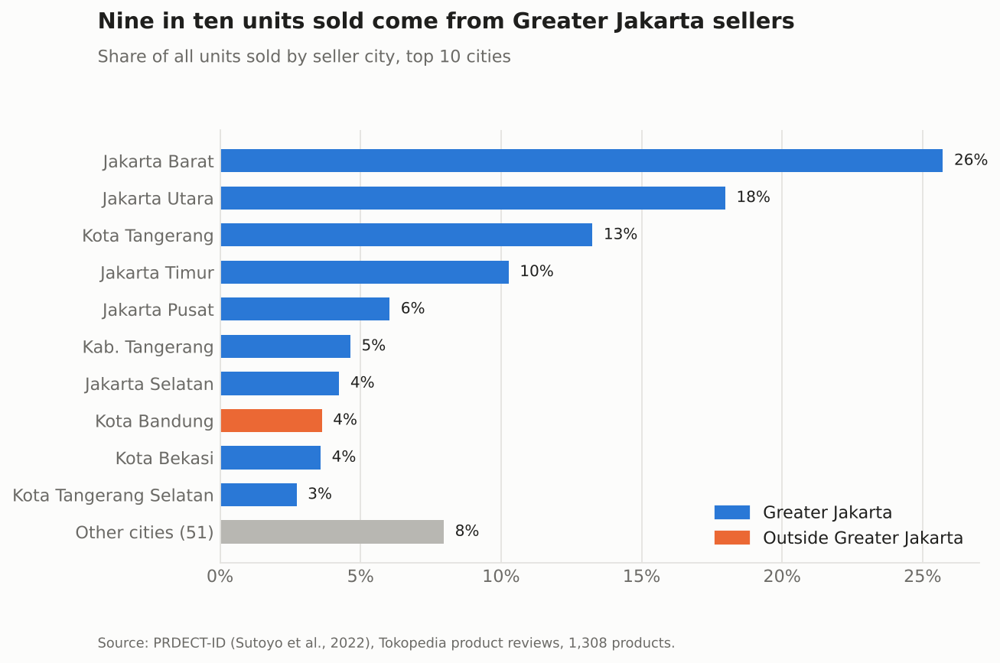
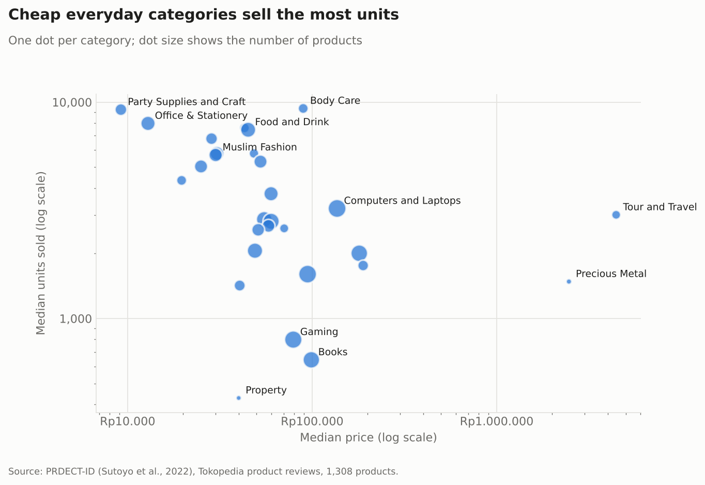
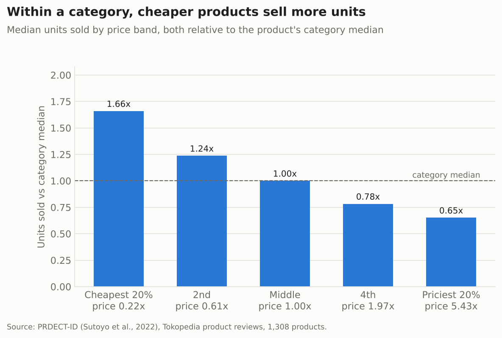
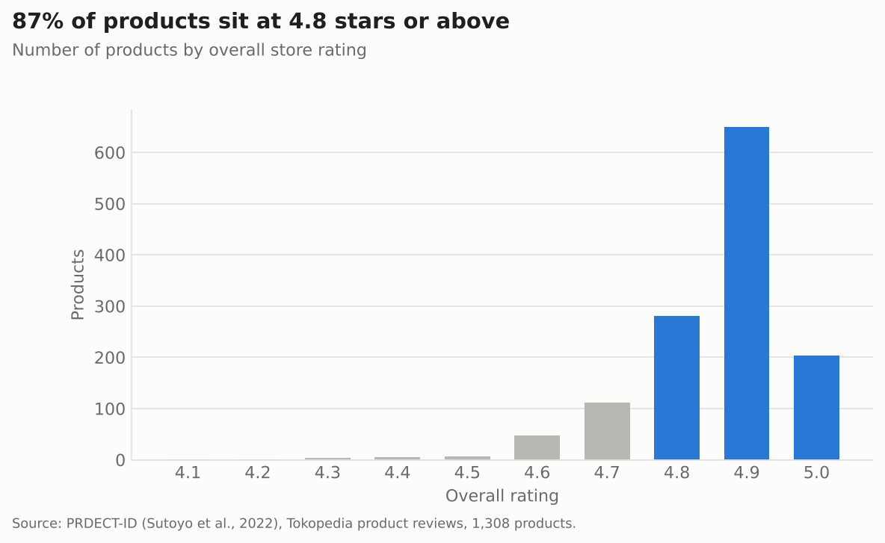
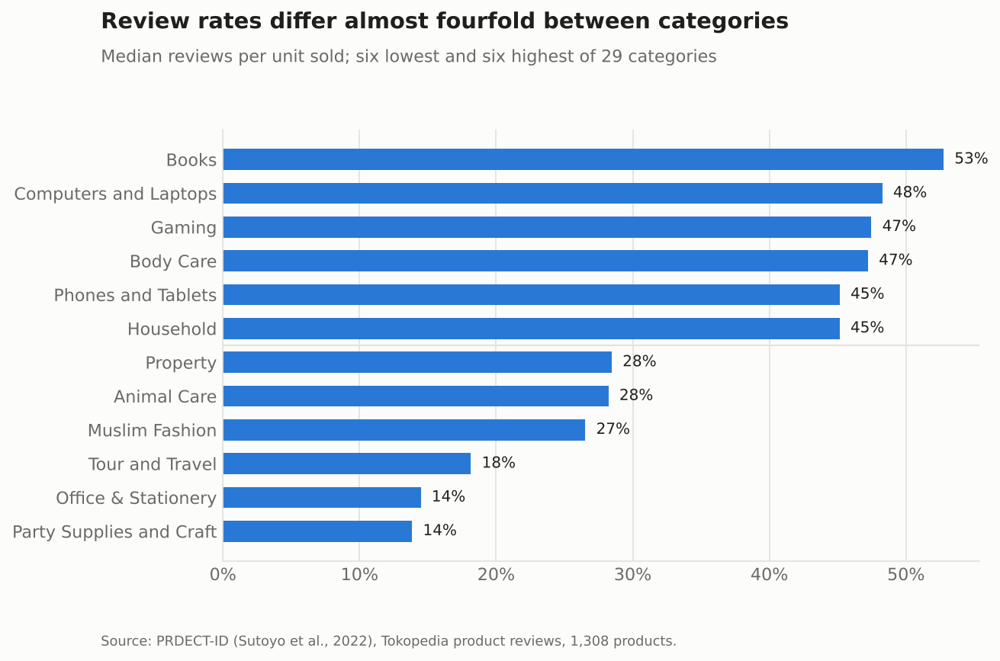

# What sells on Tokopedia

Product-level analysis of 1,308 Tokopedia products in 29 categories, built from the PRDECT-ID dataset. It looks at where sellers are based, how price and units sold vary between and within categories, how much the star rating says, and how many buyers leave a review.

The full walkthrough with code is in [`notebooks/tokopedia_products.ipynb`](notebooks/tokopedia_products.ipynb).

## Findings

**Sales are concentrated in Greater Jakarta.** Sellers in Jakarta, Tangerang, Bekasi, Depok and Bogor list 87% of the products and account for 92% of units sold. Jakarta Barat alone has a quarter of the products and 26% of units.



**Cheap, frequently bought categories move the most units.** Party supplies, stationery, body care and food have median sales above 7,000 units per product. Books, gaming and property sit below 1,000.



**Within a category, cheaper products sell more.** Comparing each product with its own category's median, the cheapest fifth sells 1.66 times the median and the priciest fifth 0.65 times. A regression with category fixed effects puts it at about 4% fewer units for a 10% higher price (coefficient on log price -0.41, robust SE 0.03). This compares different products at different prices, so it is an association rather than a price elasticity.



**Star ratings barely separate products.** 87% of products are rated 4.8 or higher. The small differences that remain still matter: 0.1 more stars goes with about 16% more units sold, holding price and category fixed.



**Review counts are a poor stand-in for sales.** The median product has 0.39 reviews per unit sold, but the rate runs from 14% for party supplies and stationery to 53% for books. Ranking products by review count would understate cheap bulk items by a factor of three or more against books or electronics.



The seller-location effect does not hold up once price, rating and category are controlled for: Greater Jakarta sellers sell about 17% more, but with p = 0.09.

## Method

- The data has one row per sampled review. Products are collapsed to one row each; where units sold or review counts differ between rows of the same product (39 products), the highest value is kept.
- Price comparisons inside a category use each product's price divided by its category median, so that a Rp5,000 pen and a Rp5,000,000 laptop can be put on the same axis.
- Regression: `log(units sold) ~ log(price) + rating + greater_jakarta + category`, OLS with HC3 standard errors (`results/regression.csv`).
- The review text and emotion labels are not used. The reviews were selected by the dataset authors, and in many categories the sentiment and emotion classes are split almost evenly (for example exactly a third each of anger, fear and sadness among negative reviews), so those shares describe the sampling, not the shoppers.

## Limits

PRDECT-ID is a curated sample, not a census of Tokopedia: at most 200 reviews were taken per category, and products appear only if one of their reviews was sampled. Units sold is Tokopedia's own counter, which rounds large values ("10rb+") and mixes product variants.

## Run it

```bash
pip install -r requirements.txt
jupyter notebook notebooks/tokopedia_products.ipynb
```

The data is included in `data/raw/`. The notebook writes charts to `images/` and tables to `results/`.

## Layout

```
notebooks/tokopedia_products.ipynb   the analysis
src/chart_style.py                   shared chart settings
data/raw/prdect_id.csv               PRDECT-ID, MIT license
results/                             city, category, price band and regression tables
images/                              charts
```

## Data

PRDECT-ID by Sutoyo et al. (2022), *Data in Brief* 44, 108554. [GitHub](https://github.com/rhiosutoyo/PRDECT-ID-Indonesian-Product-Reviews-Dataset), [Kaggle](https://www.kaggle.com/datasets/jocelyndumlao/prdect-id-indonesian-emotion-classification). MIT license.
